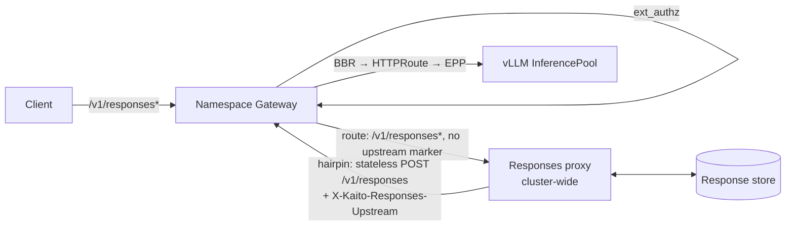

# Stateful OpenAI Responses API Support

## Table of Contents

- [Glossary](#glossary)
- [Summary](#summary)
- [Motivation](#motivation)
  - [Goals](#goals)
  - [Non-Goals/Future Work](#non-goalsfuture-work)
- [Proposal](#proposal)
  - [User Stories](#user-stories)
  - [Requirements](#requirements)
  - [Implementation Details/Notes/Constraints](#implementation-detailsnotesconstraints)
  - [Risks and Mitigations](#risks-and-mitigations)
- [Alternatives](#alternatives)
- [Upgrade Strategy](#upgrade-strategy)
- [Additional Details](#additional-details)
  - [Test Plan](#test-plan)
- [Implementation History](#implementation-history)

## Glossary

- **Responses API**: OpenAI's `/v1/responses` API. Unlike Chat Completions it can keep conversation state on the server (`store`), chain turns with `previous_response_id`, and run requests asynchronously (`background`).
- **Stored response**: a response kept by the server so it can be retrieved, chained, listed (`input_items`), cancelled or deleted later.
- **Responses proxy**: the new cluster-wide component proposed here. It owns all Responses state and forwards stateless requests to the model.
- **Hairpin request**: a request the Responses proxy sends back through the same namespace Gateway, so it takes the normal model path (ext_authz → BBR → EPP → vLLM).
- **BBR, EPP, modelharness, modeldeployment**: as defined in the [data-plane error handling proposal](./20260519-data-plane-error-handling.md#glossary).

## Summary

Production-stack serves `POST /v1/responses` today only as a stateless pass-through to vLLM. Everything that needs server-side state fails:

- `GET /v1/responses/{id}`, `GET /v1/responses/{id}/input_items`, `DELETE /v1/responses/{id}` and `POST /v1/responses/{id}/cancel` have no request body, so BBR injects no `X-Gateway-Model-Name`, no model `HTTPRoute` matches, and the namespace catch-all answers `400 invalid_request_body`.
- `previous_response_id` and `background: true` cannot work, because vLLM keeps no usable state.

This proposal adds a cluster-wide **Responses proxy** and routes every `/v1/responses*` request to it. The proxy stores responses in a pluggable store, rebuilds the conversation history for `previous_response_id`, runs background requests, and serves retrieve, list-input-items, cancel and delete. It reaches the model by sending a stateless `POST /v1/responses` back through the namespace Gateway, so authentication, BBR, EPP routing, autoscaling metrics and error mapping all keep working unchanged. vLLM is never asked to store anything.

## Motivation

The 2026-11-05 OpenAI API compatibility run (`docs/openai-api-compatibility/20261105/report.md`) found that production-stack supports Responses create and streaming, but not one of the four stored-response endpoints, while Azure AI Foundry supports all of them. These endpoints are not optional extras:

- **Agent frameworks default to server-side state.** The OpenAI Agents SDK and similar clients send only the new turn plus `previous_response_id`. Against production-stack today they fail on the second turn.
- **Long-running reasoning needs background mode.** Clients start a request with `background: true`, return immediately, and poll or cancel. Holding a streaming connection open for minutes through gateways and load balancers is fragile.
- **Auditing and data deletion need retrieve and delete.** Operators and applications must be able to read back what a model received and returned (`input_items`) and to delete stored conversations.

vLLM cannot fill the gap. Its Responses server implements only `POST /v1/responses`, `GET /v1/responses/{id}` and `POST /v1/responses/{id}/cancel`, with no `DELETE` and no `input_items`. Storage is disabled unless `VLLM_ENABLE_RESPONSES_API_STORE=1`. When enabled, it keeps everything in process memory: entries are never evicted (vLLM itself warns this leaks memory), state is lost on restart or scale-to-zero, and each replica only sees its own responses. Production-stack runs several replicas behind EPP, scales them with KEDA, and parks them at zero, so per-pod state cannot be the source of truth.

### Goals

- Support the stateful Responses API on every namespace Gateway:
  - `POST /v1/responses` with `store`, `previous_response_id` and `background`, streaming and non-streaming;
  - `GET /v1/responses/{id}` (including `stream=true` replay for background responses);
  - `GET /v1/responses/{id}/input_items` with OpenAI cursor pagination;
  - `DELETE /v1/responses/{id}`;
  - `POST /v1/responses/{id}/cancel`.
- Keep the model path unchanged: vLLM receives only stateless Responses requests, through the existing ext_authz → BBR → EPP chain.
- Isolate state per workload namespace: a response created through namespace A's Gateway is invisible to namespace B.
- Make the store durable across proxy and model restarts, scale-to-zero and replica changes, with a configurable retention period.
- Keep the feature optional: when disabled, behaviour is exactly today's.

### Non-Goals/Future Work

- The Conversations API (`/v1/conversations`) and the `conversation` request parameter. They can build on the same store later.
- Hosted tools that need other platform APIs: `file_search` (needs Files and vector stores), web search, code interpreter, remote MCP execution on the server.
- Response compaction and automatic context truncation (`truncation: "auto"`) beyond passing the parameter through.
- Sharing state across namespaces, or between production-stack and other providers.
- Making Chat Completions stateful (`store` on `/v1/chat/completions`). It can reuse the proxy later.

## Proposal

### User Stories

#### Story 1 — Agent framework chains turns

An application uses the OpenAI Agents SDK against `https://team-a.<zone>/v1`. Each turn sends the new user message and `previous_response_id`. The Responses proxy loads the stored chain, sends vLLM one stateless request containing the full history, stores the new response, and returns it. The application never resends history and works unchanged against production-stack and Azure AI Foundry.

#### Story 2 — Long reasoning job in the background

A client starts a deep-reasoning request with `background: true` and receives `status: queued` and an ID within milliseconds. It polls `GET /v1/responses/{id}` until `completed`, or calls `POST /v1/responses/{id}/cancel`, which stops the upstream generation and frees the GPU.

#### Story 3 — Operator audits and deletes

A support engineer reads `GET /v1/responses/{id}/input_items` to see exactly what the model received, then calls `DELETE /v1/responses/{id}` to honour a data-deletion request. A tenant in another namespace who guesses the ID gets `404`.

### Requirements

#### Functional Requirements

- **FR1 — Routing.** Every request whose path is `/v1/responses` or starts with `/v1/responses/` reaches the Responses proxy, regardless of method or body, after ext_authz has authenticated it.
- **FR2 — Stateless upstream.** The proxy sends vLLM `POST /v1/responses` requests with `store: false`, no `previous_response_id` and no `background`, via the namespace Gateway (hairpin), carrying the caller's credentials.
- **FR3 — Store.** When `store` is true (the OpenAI default), the proxy persists the final response object and the request's input items, keyed by namespace and response ID, before returning the final byte or event to the client.
- **FR4 — Chaining.** For `previous_response_id`, the proxy rebuilds the input as: the input items of every response in the chain, each followed by its output items, then the new input. `instructions` are not inherited, matching OpenAI semantics. A missing or foreign ID returns `404` in the OpenAI error envelope.
- **FR5 — Background.** `background: true` requires `store: true`. The proxy returns the response in `queued` state, runs the request asynchronously, and updates the stored status (`in_progress` → `completed` / `failed` / `incomplete` / `cancelled`). For background requests with `stream: true`, events are persisted so `GET /v1/responses/{id}?stream=true&starting_after=<n>` can resume.
- **FR6 — Lookups.** Retrieve, `input_items` (cursor pagination: `after`, `before`, `limit`, `order`), delete and cancel are served from the store with OpenAI-compatible bodies.
- **FR7 — IDs.** The proxy mints the response ID (`resp_` + random) before the upstream call, so background responses have an ID immediately. It rewrites the upstream `id` field in the response and in streamed events.
- **FR8 — Errors.** Errors the proxy generates use the data-plane OpenAI error envelope with `x-kaito-error-source: responses`. Errors from the model are passed through unchanged.

#### Non-Functional Requirements

- **NFR1 — Latency.** The proxy adds no buffering to streams: events are forwarded as they arrive and accumulated in parallel. Its added latency on a non-chained, non-stored request should be in the low milliseconds.
- **NFR2 — Availability.** The proxy is stateless apart from the store and runs at least 2 replicas. Any replica can serve any request.
- **NFR3 — Retention and size.** Retention defaults to 30 days and is configurable. Per-response payload size is capped, with a configurable limit; a request over the cap is still served but not stored, and `store` is reported as `false`.
- **NFR4 — Isolation.** The namespace used for every store key comes from a header the Gateway overwrites, never from client input.

### Implementation Details/Notes/Constraints

#### Architecture



#### Request path and routing

The client-facing route follows the existing model-discovery pattern in `charts/modelharness/templates/envoyfilter-not-found.yaml`, where `/v1/models` is sent to the cluster-wide `productionstack-status-reporter` Service by cluster FQDN, and `X-Kaito-Gateway-Namespace` is overwritten so a caller cannot read another namespace. Two routing facts constrain the design:

1. **Model routes would win.** Each modeldeployment `HTTPRoute` matches `PathPrefix: /` plus `X-Gateway-Model-Name`. A `POST /v1/responses` with a `model` field gets that header from BBR, so a route appended after the HTTPRoutes (as `/v1/models` is today) would never see it. The Responses route must therefore be **inserted before** the Gateway's generated routes: an `EnvoyFilter` with `applyTo: HTTP_ROUTE`, `operation: INSERT_FIRST` on the namespace Gateway's virtual host.
2. **The hairpin must not loop.** The proxy's own upstream `POST /v1/responses` comes back through the same Gateway. The Responses route matches only when `X-Kaito-Responses-Upstream` is **absent** (`present_match: true`, `invert_match: true`), so the hairpin request falls through to the normal model `HTTPRoute`. No modeldeployment change is needed.

A client that sets `X-Kaito-Responses-Upstream` itself only bypasses the proxy and gets today's stateless behaviour; it is still authenticated, so this is not a security boundary. The Gateway may strip the header from external requests in a later iteration if consistent behaviour is wanted.

The new route, rendered by `charts/modelharness` when `responsesAPI.enabled=true`:

```yaml
# INSERT_FIRST on the namespace Gateway's virtual host
match:
  safe_regex: { regex: "^/v1/responses(/.*)?$" }   # path only; query allowed
  headers:
    - name: x-kaito-responses-upstream
      present_match: true
      invert_match: true
route:
  cluster: outbound|<port>||productionstack-responses.<release-ns>.svc.cluster.local
  timeout: 0s            # streams and background lookups can be long-lived
request_headers_to_add:
  - header: { key: X-Kaito-Gateway-Namespace, value: <namespace> }
    append_action: OVERWRITE_IF_EXISTS_OR_ADD
```

ext_authz runs before route selection, so requests to the proxy are authenticated exactly like model requests, and the proxy forwards the caller's `Authorization` / `api-key` header on the hairpin so the second pass is authenticated too.

#### Hairpin target

The proxy reaches the namespace Gateway through its in-cluster Service, not the public endpoint:

- **Non-Azure** (`gatewayClassName: istio`, HTTP listener on `gatewayPort`, default 80): `http://<gateway>-istio.<namespace>.svc:<gatewayPort>`.
- **Azure App Routing** (`approuting-istio`, HTTPS-only listener with hostname `<namespace>.<zone>`): `https://<gateway>-approuting-istio.<namespace>.svc:443`, with TLS SNI and `Host` set to `<namespace>.<zone>` and the certificate verified against that hostname.

The namespace comes from `X-Kaito-Gateway-Namespace`. The proxy reads the namespace's `Gateway` object (class and listeners) through an informer to choose the scheme, port and hostname. The Service names follow the Istio and App Routing conventions (`<gateway>-istio`, as in the E2E helper `istioGatewayServiceName`; `<gateway>-approuting-istio` on AI Manager clusters).

#### Proxy behaviour

`POST /v1/responses`:

1. Resolve the namespace and parse the request.
2. If `previous_response_id` is set, load the chain from the store, oldest first, for this namespace. Build the upstream `input` as the chained input items and output items followed by the new input. Fail with `404` if any link is missing, deleted or expired.
3. Mint the response ID. If `store` is true, write the input items and a `queued` / `in_progress` record.
4. Send the stateless request upstream: same body minus `store`, `previous_response_id` and `background`, plus `store: false`, plus the rebuilt `input`.
5. Non-streaming: rewrite `id`, persist the final object, return it. Streaming: forward each event as it arrives with `id` rewritten, and persist the final object from `response.completed` / `response.incomplete` / `response.failed`.
6. Background: return the `queued` record immediately; a worker on this replica runs steps 4–5 and updates the record.

`GET /v1/responses/{id}`, `GET …/input_items`, `DELETE`: served from the store. A deleted, expired or foreign ID returns `404`.

`POST /v1/responses/{id}/cancel`: only for background responses. The store records `cancel_requested`. The owning replica polls the flag (or receives it through the store's notification mechanism), aborts the upstream request (closing the connection stops vLLM's generation), and marks the response `cancelled`. If the owning replica died, a lease on the record expires and any replica marks it `failed`.

#### Store

A small `ResponseStore` interface with namespace-scoped operations: put and get the response, put and list input items, update status, delete, record and read stream events, and acquire, renew and release a background lease. Planned drivers:

| Driver | Use | Notes |
|---|---|---|
| `memory` | Tests and the gpu-node-mocker E2E only | Rejected at startup when `replicas > 1` |
| `redis` | Default for self-managed clusters | In-cluster Redis with AOF, or a managed Redis; TTL per key gives retention |
| `azure` | AKS / AI Manager | Azure Cosmos DB for records and leases, Azure Blob for large payloads, via workload identity |

Keys are `<namespace>/<response-id>`. Retention uses the backend's TTL. Payloads above a threshold (images, large tool outputs) go to blob storage, with only a reference in the record.

#### Chart and component changes

| Component | Change |
|---|---|
| `charts/productionstack` | New subchart `productionstack-responses`: Deployment (≥ 2 replicas, soft anti-affinity, PDB), Service, ServiceAccount with workload-identity annotations for the `azure` driver, RBAC to read `Gateway` objects, values for the store driver, retention and payload cap. Disabled by default in the first release. |
| `charts/modelharness` | `responsesAPI.enabled`, `responsesAPI.serviceNamespace`, `responsesAPI.servicePort`. Renders the `INSERT_FIRST` route and adds the Responses route to the consolidated outage `local_reply` attribution. |
| `charts/modeldeployment` | No change. |
| New Go component `cmd/productionstack-responses` | The proxy. It shares the namespace-header and error-envelope helpers with the status reporter's model-discovery handler. |
| `productionstack-status-reporter` | New cluster reason `clusterResponsesNotReady`: the proxy Deployment is not ready, or the proxy's store health endpoint reports the store unreachable. |
| Data-plane error handling | New `x-kaito-error-source: responses`. A proxy outage is a local `5xx` with the model header absent and the `UH` flag, so it is reported as `502 gateway_unavailable`, the same as a model-discovery outage. The proxy's own errors (`404` for unknown IDs, `400` for an invalid chain, `background` without `store`) use the envelope directly. |

#### Interaction with existing behaviour

- **Autoscaling and EPP.** All generation still reaches vLLM through the InferencePool, so KEDA metrics, scale-from-zero activation and EPP prefix-cache routing are unchanged. Chained requests resend the same history prefix every turn, which EPP's prefix-cache scorer routes to the same replica, so KV-cache reuse works without per-replica state.
- **Model discovery.** Unaffected.
- **Authentication.** Unchanged: ext_authz runs on the client request and again on the hairpin.
- **Rate limiting and quota (future).** Requests are counted at the model route, once per generation.

### Risks and Mitigations

- **Double hop through the Gateway.** It adds latency and Gateway load. Mitigation: streaming pass-through, keep-alive connection pools per namespace, and an E2E latency check. If it proves significant, a later iteration can let the proxy call the InferencePool through EPP directly.
- **Growing context on long chains.** Rebuilt history can exceed the model context. Mitigation: pass `truncation` through; with `truncation: "disabled"` (the default) the model's error is returned unchanged, matching OpenAI. Expose chain length as a metric.
- **Prior output items that vLLM cannot accept as input.** Examples are reasoning items or server-side tool items. Mitigation: the proxy normalizes known item types (reasoning items can be dropped or converted, configurable per namespace), and E2E covers reasoning and tool-call chains on real models.
- **Store outage.** Stored or chained requests return `503` with `x-kaito-error-source: responses`. Requests with `store: false` and no `previous_response_id` still succeed, because the proxy never touches the store for them. The status reporter raises `clusterResponsesNotReady`.
- **Sensitive data at rest.** Stored inputs and outputs may contain personal data. Mitigation: retention TTL, `DELETE`, encryption at rest by the backend, and per-namespace keys. Document that `store: false` keeps nothing.
- **Background work lost on proxy crash.** A lease expiry marks the response `failed`; the client can retry.

## Alternatives

- **vLLM's built-in store (`VLLM_ENABLE_RESPONSES_API_STORE=1`) with sticky routing by response ID.** Rejected:
  - state is per process, unbounded (vLLM warns of the memory leak) and lost on restart or scale-to-zero;
  - it has no `DELETE` or `input_items`;
  - it needs ID-to-replica affinity that conflicts with EPP's load-aware routing;
  - it gives no namespace isolation beyond the model.
- **Capture state in an Envoy ext_proc filter on the model route, with no proxy.** It could store responses, but `previous_response_id` requires rewriting the request body with history before EPP and vLLM see it, and background mode needs work that outlives the client connection. Both are awkward in ext_proc. Rejected in favour of a dedicated service, which can still use ext_proc later as an optimization.
- **Translate Responses to Chat Completions in the proxy.** It would avoid depending on vLLM's Responses implementation, but it loses Responses-only semantics (reasoning items, typed output items, Responses-native tool calling). Rejected; vLLM's stateless Responses is used as the upstream.
- **Adopt an existing OpenAI-compatible proxy (for example LiteLLM).** It adds a large dependency with its own authentication, routing and configuration model, which would duplicate ext_authz, BBR and EPP. Rejected for now; the store interface keeps the option open.
- **Status quo: clients resend full history with `store: false`.** It works today, but agent frameworks and Foundry-portable applications don't do this, so it does not meet the goals.

## Upgrade Strategy

- **Off by default.** `productionstack-responses.enabled=false` and modelharness `responsesAPI.enabled=false` keep today's behaviour. `POST /v1/responses` keeps going straight to vLLM, and the lookups keep returning `400 invalid_request_body`.
- **Enabling.** Install or upgrade the umbrella chart with the proxy and a store, then upgrade each modelharness release with `responsesAPI.enabled=true`. Namespaces can opt in one at a time.
- **Disabling.** Removing the route sends `POST /v1/responses` straight to vLLM again; stored data stays in the store until it expires.

## Additional Details

### Test Plan

**Unit tests** (`cmd/productionstack-responses`, `pkg/...`):

- chain rebuild order, `instructions` not inherited, missing-link `404`;
- ID rewriting in non-streaming bodies and every streamed event type;
- store drivers against a shared conformance suite (`memory`, `redis`; `azure` against emulators where available);
- `input_items` pagination;
- lease expiry and cancel propagation;
- payload cap: a request over the cap is still served and returns `store: false`.

**E2E** (`test/e2e/`, gpu-node-mocker, `memory` store with a single proxy replica, then `redis` with 2 replicas):

| Spec | Scenario | Asserted outcome |
|---|---|---|
| `responses_store_spec.go` | create with `store: true`, then retrieve, `input_items`, delete, retrieve | 200 / 200 with input items / 200 `deleted: true` / 404 |
| `responses_store_spec.go` | create with `store: false`, then retrieve | 404 |
| `responses_chain_spec.go` | 3 turns via `previous_response_id` | Each turn 200; the hairpin request seen by the model contains all prior items |
| `responses_chain_spec.go` | `previous_response_id` from another namespace | 404 |
| `responses_background_spec.go` | `background: true`, poll to `completed`; second request cancelled | `queued` → `completed`; `cancelled`, and the model sees the request aborted |
| `responses_outage_spec.go` (Serial) | Scale the proxy to zero | `502 gateway_unavailable`, `x-kaito-error-source: gateway`; recovery after restore |
| `responses_ha_spec.go` (Serial) | Kill one proxy replica mid-stream and mid-background | Stream fails cleanly; background response marked `failed` after lease expiry; new requests served |

**Compatibility run.** Re-run the `docs/llmprobe` suite. The four stored-response cases (`responses-get`, `responses-input-items`, `responses-delete`, `responses-cancel`) must move from Not supported to Supported, with real stored objects instead of nonexistent-ID probes.

## Implementation History

- [ ] 2026-11-05: Proposal drafted (`provisional`)
- [ ] TBD: Phase 1: proxy, routing, `memory` and `redis` stores, `store`, retrieve, `input_items`, delete, `previous_response_id`
- [ ] TBD: Phase 2: background mode, cancel, stream resume (`starting_after`), `azure` store driver
- [ ] TBD: Phase 3 (future): Conversations API, stateful Chat Completions (`store`), hosted tools that depend on Files and vector stores
